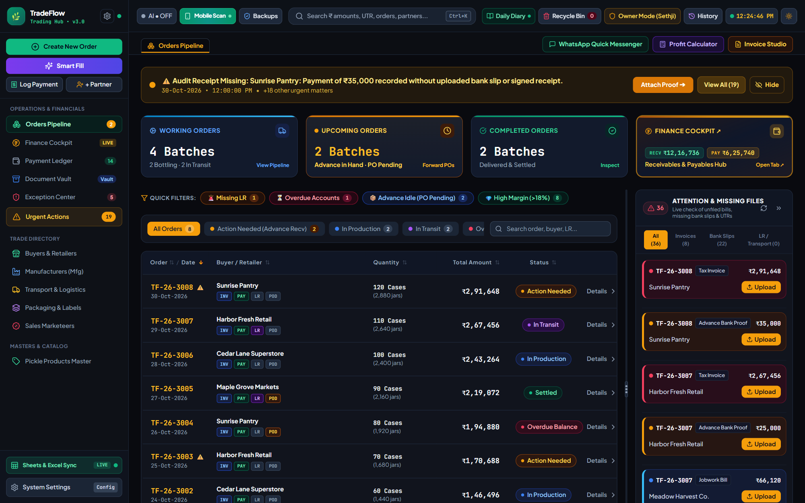
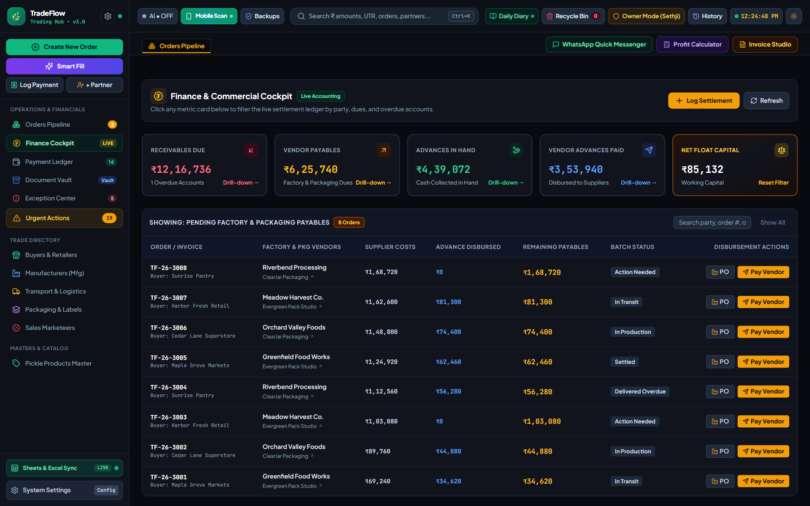
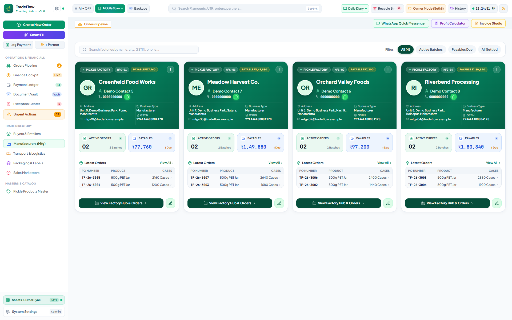
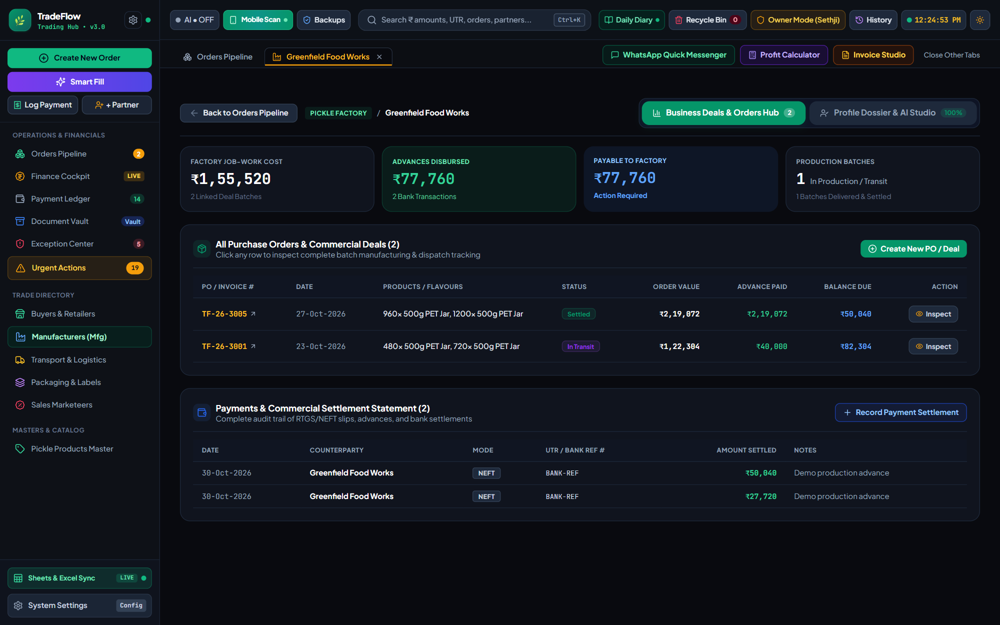
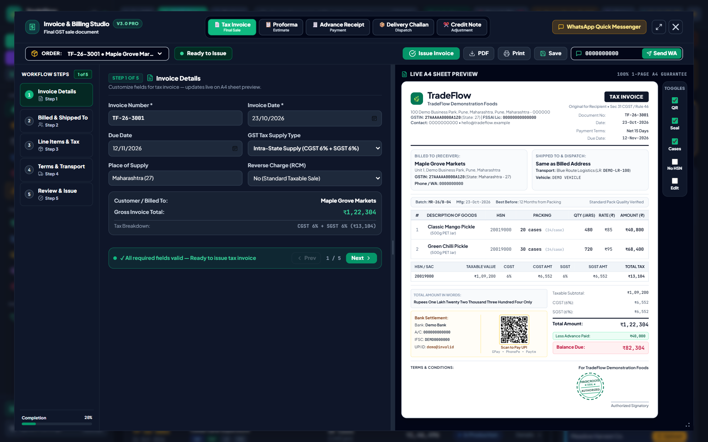
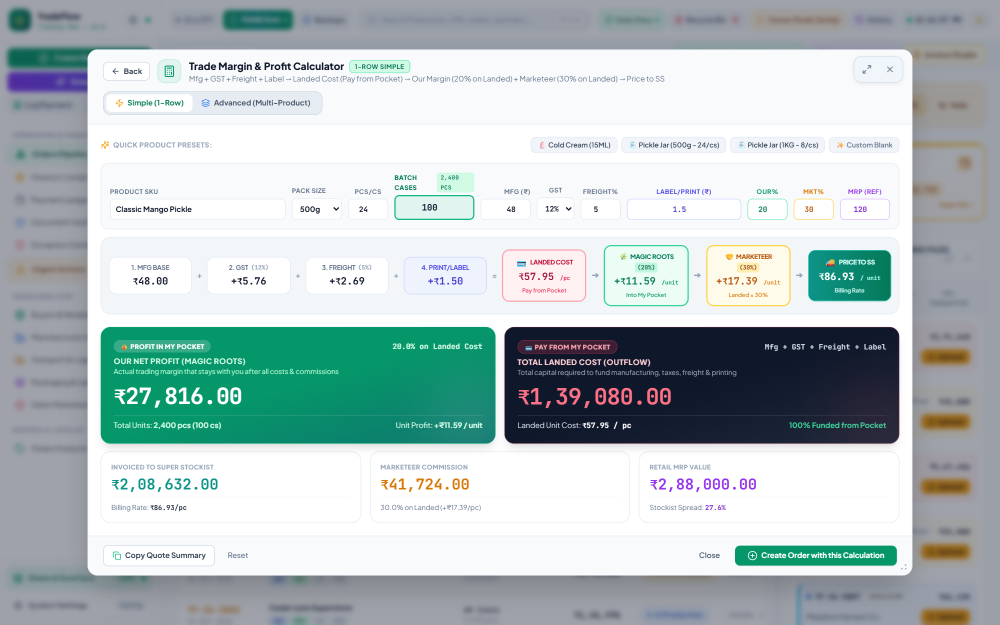
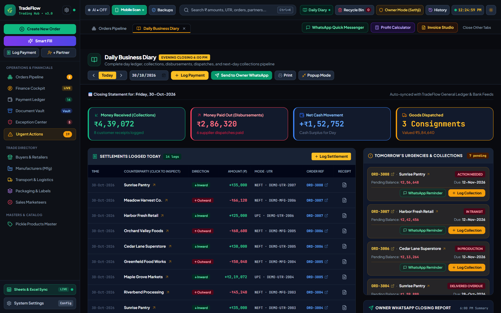
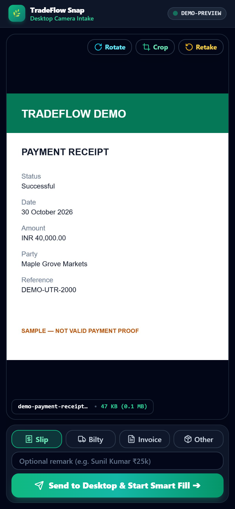

<div align="center">

# TradeFlow 3

**Orders, partner operations, billing and commercial visibility — in one local workstation.**


[Screenshots](#a-look-inside) · [Quick start](#quick-start) · [Architecture](docs/ARCHITECTURE.md) · [Security](SECURITY.md) · [Verification](docs/VERIFICATION.md)

</div>

TradeFlow is a Windows-first commercial workstation for food manufacturing, wholesale and distribution workflows. It connects the order pipeline with suppliers, factories, transport, customer payments and invoice preparation. SQLite keeps the authoritative records; a synchronized Excel workbook supports familiar spreadsheet workflows.

[](docs/screenshots/01-orders-pipeline.png)

> Every screenshot uses fictional demonstration data. Contact information, tax identifiers, bank details and payment references are placeholders. Live business records and documents are excluded from this repository.

## What you can do

| Workspace | What it brings together |
| --- | --- |
| **Orders pipeline** | Lifecycle status, urgency, advances, outstanding amounts and manufacturing/dispatch details. |
| **Partner workspaces** | Retailers, manufacturers, packaging vendors, marketeers and transporters with linked orders and settlements. |
| **Invoice & billing studio** | Tax invoices, proformas, advance receipts, delivery challans and credit-note preparation, with previews and PDF output. |
| **Commercial cockpit** | Receivables, payables, direct costs, broker commission and trade profitability. |
| **Profit calculator** | Manufacturing, tax, freight and packaging inputs, with landed outflow, own profit and selling-price breakdowns. |
| **Document intake** | Local OCR for images/PDFs, review-before-save Smart Fill, paired phone capture and a document vault. |
| **Daily diary & recovery** | Activity visibility, payment chronology, rollback tools, backups and Excel synchronization. |

## A look inside

### Finance and supply-chain visibility

| Commercial & finance cockpit | Manufacturer directory |
| --- | --- |
| [](docs/screenshots/02-finance-cockpit.png) | [](docs/screenshots/03-partner-directory.png) |
| Outstanding balances and financial movement in one view. | Compact partner cards with linked work and commercial context. |

### From partner context to billing

| Dedicated partner workspace | Invoice & billing studio |
| --- | --- |
| [](docs/screenshots/04-partner-workspace.png) | [](docs/screenshots/05-invoice-studio.png) |
| Inspect a partner's profile, order activity and settlement position. | Prepare documents alongside the live A4 preview. |

### Pricing and daily operations

| Profit & outflow calculator | Daily business diary |
| --- | --- |
| [](docs/screenshots/06-profit-calculator.png) | [](docs/screenshots/07-daily-diary.png) |
| See the effect of rates, freight and margins before booking. | Review the day's receipts, payments and follow-up work. |

### Phone capture

<p align="center"><a href="docs/screenshots/08-mobile-capture.png"></a></p>

Pair a phone from the desktop QR screen, capture a slip and send it to the local workstation for review. QR codes are generated locally. Guest sessions expire; saved-device pairing can be revoked. The image above is explicitly marked as a sample receipt.

## Quick start

### Requirements

- Windows 10/11 and **Node.js 24 or newer**.
- A current Edge or Chrome browser.
- **Python 3.12** for the optional local OCR engine.

### Install and launch

```powershell
git clone https://github.com/aimummatv/TradeFlow-v3.git
cd TradeFlow-v3
npm ci --omit=dev
```

Double-click **`start.server.bat`**, or run:

```powershell
npm start
```

Open **http://localhost:3000** and keep the server window open. The first launch copies the fictional example into the ignored `data/` folder, initializes SQLite and starts Excel synchronization. An occupied port produces an explanation; TradeFlow does not stop the other process.

Choose another port when needed:

```powershell
$env:PORT = '3002'
node server.js --open
```

### Enable local OCR

```powershell
powershell -NoProfile -ExecutionPolicy Bypass -File scripts/setup-ocr.ps1 -Python 'C:\path\to\python.exe'
```

The script builds `rapidocr/.venv/` from pinned requirements. The environment is generated locally and is not committed. OCR supports images and PDFs up to 20 pages, limits rendered dimensions and uses a 90-second subprocess timeout. Always review extracted values before saving. Cloud AI features require your own provider configuration and internet access.

### Bring across your existing data

Stop both servers, back up your existing TradeFlow folder, then copy its **entire `data/` folder** into the checkout before starting it. This includes documents as well as database files. Do not replace existing business data with the demo seed.

All runtime data stays under ignored `data/`. The committed seed is in `examples/demo-data.js`; application saves update the runtime mirror, leaving the committed example unchanged.

## Storage and project layout

```text
TradeFlow-v3/
├── server.js                  Local HTTP API, SSE, documents and OCR bridge
├── security.js                Request, origin, host and file-path checks
├── db_manager.js              SQLite records, activity and rollback
├── sync_manager.js            Runtime seed and two-way Excel synchronization
├── backup_manager.js          Consistent snapshots and recovery
├── index.html                 Desktop application
├── mobile_snap.html           Paired phone capture
├── css/  js/                  Interface and rendering helpers
├── lib/  vendor/              Pinned browser assets and Excel tarball
├── examples/demo-data.js      Fictional, immutable starter dataset
├── rapidocr/                  OCR source and locked requirements
├── scripts/                   Launch, setup, vendor build and capture helpers
├── tests/                     Isolated regression/browser/OCR checks
└── docs/                      Architecture, verification and screenshots

data/                          Created locally; excluded from Git
node_modules/                  Installed locally; excluded from Git
rapidocr/.venv/                Rebuilt locally; excluded from Git
```

Back up the **whole `data/` folder** externally. Database/JSON snapshots preserve records; attachments also need to be retained. See [architecture and recovery details](docs/ARCHITECTURE.md).

## Verification and development

```powershell
npm ci
npm test
npm run test:browser
npm run test:ocr
npm audit
```

Regression tests use temporary data. Browser checks exercise real application screens, calculator totals, PDF generation/rendering, local QR creation and imported-text escaping. OCR checks use generated images and PDFs. [Verification notes](docs/VERIFICATION.md) distinguish checked behavior from integrations requiring manual acceptance.

To regenerate the gallery from the fictional example:

```powershell
npm run screenshots
```

Set `BROWSER_PATH` if automatic Edge/Chrome detection cannot find your browser. Use `npm run vendor:build` to rebuild npm-sourced browser libraries after installing development dependencies. Retained versions and licenses are listed in [third-party notices](THIRD_PARTY_NOTICES.md).

## Security and operating scope

- Desktop APIs require a loopback connection; remote devices are limited to capture resources and paired uploads.
- Requests are checked for origin/host, body size and JSON shape. File access is restricted to the project data directory.
- Imported values are escaped at rendering boundaries; rich messages are sanitized. Browser libraries and dependency versions are pinned.
- **Owner/Operator changes visibility, not authenticated permissions.** There is no account login or separate server-side user-role system.
- Use locally on a trusted Windows account. Public hosting and shared-user operation need further authentication and authorization work.

This project does not certify statutory compliance or every financial edge case. Review real invoices, allocation, printing and Excel workflows before relying on it operationally. See [SECURITY.md](SECURITY.md).

## License

Proprietary application code. Existing ownership and copyright notices are retained; no open-source license is granted. Third-party components remain under their respective licenses. See [LICENSE](LICENSE) and [THIRD_PARTY_NOTICES.md](THIRD_PARTY_NOTICES.md).
