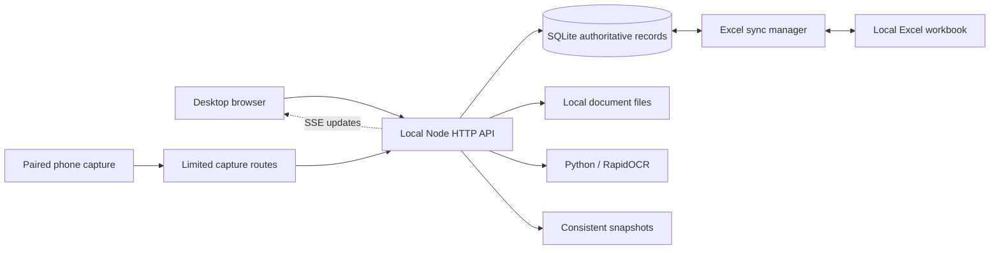

# Architecture and data lifecycle

## Startup and storage

`server.js` initializes the sync manager. If no runtime seed exists, the fictional committed example is copied from `examples/demo-data.js` to `data/mock-data.js`. SQLite is initialized from the runtime seed when needed. App saves update SQLite and the ignored runtime mirror; they do not change the example file.

`db_manager.js` holds records, metadata, activity history and payment-proof registrations. Whole-state saves validate IDs and numeric fields and apply changes transactionally. Unchanged orders, contacts and payments avoid repeated audit entries. The application uses a full-state model; concurrent editing from multiple windows needs particular acceptance testing.

`sync_manager.js` manages the local workbook and change notifications. Excel may temporarily lock its file while application data remains saved to SQLite. Review sync status and close Excel before retrying a blocked export.

## Documents and OCR

Documents remain local under `data/`. The API constrains supported types and resolves access inside the data directory. Smart Fill stages extracted values for review. The optional Python environment is built from locked requirements; image/page dimensions, PDF page count and subprocess time are bounded.

## Backup and recovery

Database snapshots use SQLite-consistent operations that include committed WAL data. Restore creates a safety checkpoint and reports database errors. JSON recovery includes the payment-proof registry.

Keep an external backup of the entire `data/` directory. JSON/database snapshots preserve structured records, while order/partner attachments also need their files. Stop the server before manually replacing a complete data directory; preserve its coherent database files and document layout.

## Security boundaries

Desktop routes are local-only. Other devices are limited to capture resources and token-based uploads. Origin/host validation restricts hostile browser requests; local users and software with access to the Windows account remain trusted. Owner/Operator does not create an authenticated user boundary. See [SECURITY.md](../SECURITY.md).
